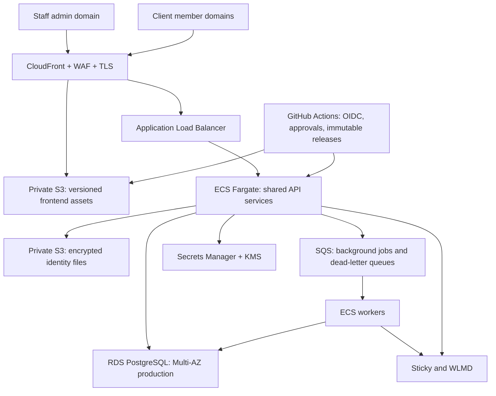

# AWS platform and release plan

Status: proposed architecture and implementation sequence, 24 October 2026.
No AWS account exists yet. No AWS resources, DNS records, credentials, database
migrations or production routing were created or changed by this planning work.

## Decisions confirmed by the owner

- Move the shared admin, application-owned database and patient portals to AWS.
- Support 200+ branded sites on one maintainable platform.
- Each client's portal uses its own subdomain, such as `members.client.com`.
- Give clients exact DNS setup instructions and show verification status.
- Staging and production need an easy, repeatable release process.
- The business owner and designated team leads approve production releases.
- Keep Sticky as the membership, order and subscription provider; retain Stripe
  Connect v2 through Sticky, and the configured WLMD integrations.
- The platform remains responsible for site isolation, patient grants, intake
  records, identity artifacts, journals and application sessions.

Recommended initial region: `us-east-1`, subject to the owner's data-residency
and contractual requirements. This is a recommendation, not a confirmed region.

## 1. Target architecture

One shared application release and one shared portal codebase. Branding, domain,
campaign, WLMD mapping, catalog and enabled features belong to site configuration.
Adding a site is a configuration/provisioning operation, not a code fork or a
separate application deployment. Separate AWS accounts isolate environments.

| Layer | Proposed setup | Reason |
| --- | --- | --- |
| Account foundation | AWS Organizations; management, staging and production accounts | Environment, billing and IAM boundaries |
| Operator access | IAM Identity Center, MFA and named users/roles | No shared root/developer credentials |
| Compute | ECS Fargate; separate API and worker services | Managed containers and controlled scaling |
| Production availability | API tasks across at least two Availability Zones, after stateless migration | Survive task/AZ failure without losing a checkout |
| Database | RDS PostgreSQL, Multi-AZ in production, private subnets | Transactions, concurrency and managed recovery |
| Static delivery | Private S3 with CloudFront OAC | Versioned releases and cached assets |
| Client domains | CloudFront SaaS Manager distribution tenants and managed TLS | Reusable portal delivery settings per client |
| Identity documents | Separate private S3 bucket, KMS encryption, scoped access and lifecycle policy | Remove sensitive file dependency on a single disk |
| Integrations | Existing backend Sticky/WLMD adapters | Preserve current provider contracts and credentials |
| Background work | SQS + workers, transactional outbox, deduplication and DLQs | Durable sync, provisioning and bounded retries |
| Secrets | Secrets Manager and KMS, separate per environment | Rotation, controlled decrypt access and audit |
| Monitoring | CloudWatch metrics/logs/alarms, CloudTrail, budget alerts | Detect problems and record privileged changes |
| Infrastructure | Terraform modules, independently locked state per environment | Repeatable setup and reviewed changes |

CloudFront SaaS Manager supports shared configuration with tenant-specific
domains/certificates. It does not support CloudFront continuous deployment;
use separate staging/prod distributions and versioned asset releases, rather
than relying on that unsupported feature. Confirm provider/IaC versions and
quotas in the initial spike. [AWS multi-tenant distributions](https://docs.aws.amazon.com/AmazonCloudFront/latest/DeveloperGuide/distribution-config-options.html)

## 2. Application changes required before production scaling

The current app deliberately runs one Uvicorn worker on one Fly machine.
`app.py` uses SQLite, an in-process payment lock and a memory-only payment client
secret cache. `entrypoint.py` fixes `--workers 1`; several portal operations also
use process-local locks and encryption keys on `/data`. Simply launching two
copies would not provide a safe production architecture.

Required changes:

1. Add a PostgreSQL persistence layer and versioned migrations. Inventory every
   SQLite database, JSON manifest and local key; migrate admin reviews, catalog,
   orders, patient grants, intake, sessions, refill journals and identity metadata.
2. Replace process-only payment/refill locks with database atomic transitions,
   unique constraints and bounded leases. Use a transactional operation journal.
   Provider uncertainty stays held until read-only reconciliation establishes
   the result; a worker retry must never create a second charge or refill.
3. Design secure resumable payment state. Prefer provider-supported retrieval
   when available; otherwise persist only necessary client secrets encrypted
   with tightly scoped KMS access, short retention and exact checkout ownership.
   Verify the provider contract before choosing this implementation. Never
   persist raw card data, SSN digits or secrets in telemetry.
4. Move private uploads to encrypted S3 and migrate volume encryption keys
   deliberately. Preserve the ability to decrypt existing records; changing
   key storage must not strand stored IDs, membership tokens or drafts.
5. Move deployment-owned site publication manifests into versioned database
   configuration. Preserve exact approved campaign/SKU/offer mappings.
6. Establish strict tenant boundaries in application and database: site IDs,
   composite constraints, row-level policies where appropriate, non-bypass
   runtime roles and per-request transaction scope. Test connection-pool reuse
   and cross-site access. Client-provided site IDs alone never prove access.
7. Add staff accounts, MFA/SSO and roles: platform owner, release lead, site
   manager and support. Keep Sticky patient authentication; do not introduce a
   second patient password system. Admin audit trails record who changed what.
8. Add readiness/liveness checks, graceful shutdown/draining, background job
   ownership and correlation IDs. Redact query strings and sensitive payloads.

Start with PostgreSQL-backed durable state. Redis is optional for measured cache
or rate-limit needs, not an initial dependency or a payment source of truth.
AWS hosting will not itself remove Sticky's upstream quote latency; measure our
time separately from provider time and preserve authoritative total checks.

## 3. Per-site patient portal domains

Owner/team workflow:

1. Open Sites → select site → Portal domain.
2. Enter `members.client.com` and select the portal release/branding.
3. The app validates uniqueness and issues a domain-ownership challenge.
4. A provisioning worker creates the distribution tenant/certificate request.
5. Show the exact returned ownership, certificate and routing DNS records for
   the client's DNS provider. Do not assume clients must move their whole DNS
   zone to Route 53.
6. Check DNS and TLS automatically. Display `Waiting for DNS`, `Verifying TLS`,
   `Ready to preview`, `Live` or an actionable error.
7. Publish only after ownership, TLS, routing and site-isolation checks pass.
8. Monitor certificate renewal and DNS drift. Retiring a domain removes its
   mapping and prevents reassignment without a new ownership challenge.

The frontend release is shared; each site can pin an approved frontend version
and compatible feature flags. The backend remains a shared, versioned API with
backward compatibility. Do not promise independent backend code versions for
each client without a separate deployment-ring design.

Prefer same-origin portal API requests through controlled edge routing to avoid
third-party-cookie dependency. Edge-to-origin tenant context must be derived
from a verified host/tenant mapping, overwritten rather than trusted from visitor
headers, and checked against the authenticated patient's site grants. Unknown
hosts fail closed; API, intake, identity and authenticated responses are not CDN
cached. If cross-origin storefront APIs are used, register exact verified origins
for patient endpoints; public catalog CORS is a separate policy.

DNS onboarding/certificate mechanics follow the actual AWS responses.
[AWS tenant certificates and domain setup](https://docs.aws.amazon.com/AmazonCloudFront/latest/DeveloperGuide/managed-cloudfront-certificates.html)

## 4. Releases the team can operate

Initial control surface: GitHub Actions and protected release environments.
An admin Deployments screen can expose the same workflow afterward; it should
not be required to ship the first AWS release or depend on the app being healthy.

### Everyday flow

1. Developer opens a branch and pull request.
2. CI runs backend/browser tests, tenant-isolation checks, migration checks,
   secret scanning and dependency/container scanning.
3. A merge builds one immutable container image and versioned frontend bundle.
4. Deploy that release to staging automatically, using synthetic/sandbox
   integrations, separate credentials and no production patient database.
5. Staging smoke, migration and recovery tests record their results against
   the image digest and asset manifest.
6. Owner or designated lead selects **Promote to production** and approves.
7. Deploy the exact tested artifacts, run health checks and monitor alarms;
   rollback application tasks/assets if the release fails.

Offer manual **Deploy staging**, **Promote release** and **Roll back release**
actions. Each shows commit, image digest, schema revision, approver, timestamp,
test result and affected environment. Serialize production deployments and
prevent duplicate dispatch. Database migrations use expand/contract changes;
automatic application rollback must not reverse destructive schema changes.

Use GitHub OIDC for short-lived AWS access, tightly scoped to this repository
and environment. Separate roles for image publishing, staging deployment,
production deployment, migrations and infrastructure. No long-lived AWS access
keys in GitHub or browser code. [AWS OIDC trust guidance](https://docs.aws.amazon.com/IAM/latest/UserGuide/id_roles_create_for-idp_oidc.html)

Confirm the repository's GitHub plan supports required deployment reviewers for
private repositories. If it does not, choose GitHub Enterprise or an AWS
CodePipeline manual-approval stage for production; a workflow button alone is
not an approval control. Prevent self-approval where a second reviewer is
required. [GitHub deployment review availability](https://docs.github.com/en/actions/how-tos/deploy/configure-and-manage-deployments/review-deployments)

Use ECS rolling deployments with health/CloudWatch rollback first, then evaluate
blue/green once migrations and distributed payment recovery are proven. Test
draining and rollback with synthetic in-flight orders before enabling production
traffic. [ECS failure detection](https://docs.aws.amazon.com/AmazonECS/latest/developerguide/deployment-failure-detection.html)

## 5. Security, recovery and operational acceptance

- Before processing patient information on AWS, complete the applicable AWS BAA
  and confirm service eligibility and configuration. Hosting on AWS is not a
  certification of this application. Review the existing Sticky/WLMD/clinical
  contracts and data paths as well. [AWS HIPAA service conditions](https://aws.amazon.com/compliance/hipaa-eligible-services-reference/)
- Private database/storage, TLS, KMS encryption, least privilege, MFA, scoped
  support access, session revocation and audit of sensitive access.
- Store neither raw SSN digits nor payment-card data. Never log request bodies,
  identity files, private tokens or patient query strings in operational logs.
- RDS automated backups and point-in-time recovery, encrypted snapshots,
  S3 retention/versioning as approved, and an independent backup access policy.
  Test restoration into an isolated environment, including all required keys.
  [RDS backup and recovery](https://docs.aws.amazon.com/AmazonRDS/latest/UserGuide/USER_WorkingWithAutomatedBackups.html)
- Define retention/deletion policies before copying identity files and patient
  data. Keep staging synthetic; restrict access to backup/restore exercises.
- Alerts for checkout failures, uncertain transactions, integration latency,
  failed refill jobs, database pressure, certificate expiry and failed backups.
- Initial targets to validate: 99.9% monthly application availability, recovery
  point ≤5 minutes and recovery time ≤60 minutes. These are proposed objectives,
  not measured guarantees or provider-inclusive SLAs.
- Load test beyond forecast peak traffic, fail a task mid-checkout, replay
  duplicate jobs, simulate provider timeouts and restore backups. No production
  approval until tenant isolation and duplicate-charge/refill protections pass.

## 6. Migration and rollout sequence

| Phase | Deliverable | Exit gate | Planning effort |
| --- | --- | --- | --- |
| 0 | AWS account, access, region, BAA, budget and approvers | Owner prerequisites confirmed | Depends on owner/account setup |
| 1 | IaC foundation, staging network/ECR/RDS/S3/IAM, OIDC pipeline | Reproducible synthetic staging deployment | 2–4 engineering days |
| 2 | PostgreSQL, keys/files, durable payment/session state and worker journal | Restart/multi-task recovery and migration tests pass | 7–12 days |
| 3 | Tenant domain provisioning, TLS, portal routing and staff permissions | Two unrelated domains pass isolation and login/intake tests | 4–7 days |
| 4 | Production promotion, rollback, monitoring and recovery rehearsal | Approved operational checklist and successful restore | 3–5 days |
| 5 | Controlled production cutover, initial site verification and broader rollout | Old/new reconciliation and agreed observation window pass | 2–3 days plus observation |

Budget roughly **4–6 weeks for a small experienced team**, depending on migration
findings, account/DNS turnaround and review. This is a planning estimate, not a
commitment. AWS foundation can be visible earlier while Fly continues serving
customers. Do not collapse the payment-state and migration gates to meet a date.

Cutover procedure:

1. Rehearse export/import and reconciliation in restricted infrastructure with
   synthetic data first. Count/check records, grants and encrypted-file references.
2. Inventory open payment/refill/identity writes; drain or hold them explicitly.
   A currently open form may be pinned to Fly's in-memory secret. Do not declare
   it portable, retry it, or create a replacement payment without reconciliation.
3. Take a protected source backup. During final migration, use a short announced
   write freeze and a single authoritative writer; avoid unproven dual writes.
4. Import final data, validate ownership/totals/configuration and reconcile
   migration counts/checksums without copying patient data into GitHub/logs.
5. Switch approved domains/API routes, smoke-test read-only and then perform
   explicitly authorized provider tests. Preserve existing public link redirects
   and route provider callbacks to the correct engine during the transition.
6. Keep Fly and its backup available through the observation window. Once AWS
   accepts new writes, DNS rollback to an old SQLite snapshot is not safe: a
   rollback requires data reconciliation or a forward fix on the current database.

## 7. Setup inputs and the next implementation package

Owner inputs still required:

- Create the AWS management account with the company's billing/security contact
  and root MFA; grant scoped access through SSO/role delegation, not keys in chat.
- Confirm region/data residency, monthly spending cap and approximate traffic.
- Choose platform admin/API base domain and the first client's portal subdomain;
  identify who can add DNS records.
- Name the release leads and confirm GitHub organization/plan approval features.
- Confirm patient-data retention, security/compliance owner and incident contact.
- Confirm usable provider sandbox/dry-run accounts for staging. Do not copy live
  credentials into staging merely to make an integration appear functional.

After architecture approval, prepare in the repository:

- `infra/aws/modules/` for network, database, services, secrets references,
  storage, domains and monitoring.
- `infra/aws/environments/staging/` and `production/` with separate locked state.
- Reviewed workflows for build, staging, production promotion and rollback.
- PostgreSQL migrations, a repeatable migration verifier and a rollback runbook.
- Domain-provisioning queue/state machine and the admin domain settings screen.
- Release inventory and deployment/incident/restore runbooks.

These are planned deliverables, not provisioned infrastructure. Obtain an AWS
Pricing Calculator estimate using agreed region, task counts, database size,
traffic, logs, backups, WAF, NAT/egress and domains before provisioning paid
resources. Add per-environment budgets immediately; database, NAT, logging and
egress costs must not be hidden behind the container price alone.
