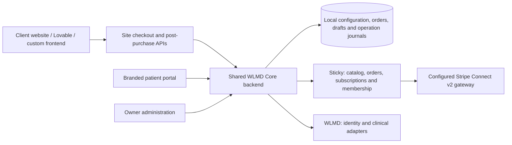

# WLMD Core: developer handoff

As of **28 October 2026**. Start here before using older feature reports or changing the live application.

## What we are building

WLMD Core is one shared platform for many branded treatment businesses. Each client selects approved therapies, products, prices and policies, connects its Sticky campaign and WLMD site, and embeds the same checkout/post-purchase integration in its own website. Patients manage their orders and care through a branded, site-specific portal.

FortifyHP is the current reference storefront. The goal is configuration-based onboarding for approximately 200 clients, without a backend deployment, Lovable fork or copied questionnaire for every client. That is a product target, **not a tested capacity claim**.

The next developer's main remit is to strengthen the Sticky integration, make new-client setup repeatable, and package the existing post-checkout experience into a supported SDK. Complete the clinical API contract alongside that work; do not rebuild the working checkout first.

## Read this source/release warning first

The repository's default branch is behind the product described here. At handoff inspection:

| Reference | Observed state |
| --- | --- |
| `main` | `f109e5151b840687d9a0731d8611acf73048b979`; older checkout administration |
| `codex/fortifyhp-onboarding` on GitHub | `f091f33b2e782ed86ff4d9fe5ac21930658477aa`; open [PR #3](https://github.com/gokulwlmd/laughing-buddha/pull/3) targets `codex/patient-portal-demo` |
| Post-purchase branch | Open [PR #4](https://github.com/gokulwlmd/laughing-buddha/pull/4) targets `codex/fortifyhp-onboarding`; do not assume its old description is current deployment evidence |
| Existing local working branch | `codex/fortifyhp-onboarding`, HEAD `994cf9c`, with substantial uncommitted work including separate AWS adaptations |
| Verified live Fly release | `registry.fly.io/wlmd-stripe-test-0f89b1bb@sha256:fe3065ff86f56dd0ed9d8bc354d6c06b7241f61124af1cc1aa42a8d38a7e845e` |

**No GitHub branch above is certified as an exact checkout of the current live release.** This documentation PR does not commit the outstanding application changes, merge existing PRs, or deploy anything. First establish a reviewed production source baseline and its tests. Do not merge the dirty working tree wholesale or assume that `main`, the latest PR, or an old `deployment.json` equals production.

The accompanying [runtime manifest](handoff-live-runtime-2026-10-28.json) records the 120 application-file hashes verified on the live machine after the last release. It is an integrity inventory, not a source archive or a complete reproducible-build attestation. Obtain the corresponding sanitized source and build inputs from the maintainer; never obtain production data to reproduce the application.

## Responsibilities and architecture



| System | Owns |
| --- | --- |
| Sticky | Actual provider catalog/billing objects, orders, recurring subscriptions and membership/password authentication |
| Stripe through Sticky | Secure payment authorization/capture and browser payment fields; do not introduce a separate charge flow |
| Our database | Site mappings, approved configuration/publications, local order views, patient/order grants, intake drafts, reusable answers, action/recovery journals and staff cases |
| WLMD | Identity/ID endpoints already connected; clinical questions/submissions and later care services require the remaining documented integration |
| Client frontend | Presentation and customer navigation using site APIs; never Sticky credentials, WLMD credentials, arbitrary prices or card storage |

Ordinary browsing should read our database. Fresh provider checks remain necessary at the relevant financial/configuration boundaries. A display cache is not permission to charge a saved price or advance a subscription.

## What exists, and what still needs proof

| Area | Current implementation | Remaining gap |
| --- | --- | --- |
| Master therapies/catalog | Reusable therapy, treatment, duration, base/`-SUB` SKU and payment choices; brand prices and coupons | Keep uncertain catalog variants unpublished; use configuration rather than proliferating client scripts |
| Client setup | Sites, templates, review/apply, provider-object journals and public publication mappings | Not yet arbitrary-client self-service; some activation/bootstrap logic remains Fortify-specific |
| Checkout APIs | Site catalogs, sessions, configuration, authoritative quote, payment preparation, completion, status and same-attempt resume | Provider latency, stronger outcome reconciliation and a supported versioned integration package |
| Multi-product purchases | Several products in one customer flow, with separate Sticky orders and exact receipts | No transactional all-or-nothing cart payment: preserve successful items when another fails; never silently bill the successful ones again |
| Post-purchase UI | Shared hosted component: confirmation, Sticky password setup, partial intake saves, identity final step and portal handoff | No published/versioned npm SDK or supported custom-UI client yet |
| Patient portal | Real Sticky order snapshots, delivery timeline/tracking when recorded, notifications, intake, refill and subscription actions | Provider capabilities differ; timeline stages must not invent clinical approval or shipment |
| Membership | Sticky is the sole live password provider; local site/order authorization remains separate | Returning purchases cannot reset an existing password; recovery requires verified ownership |
| Card updates | Sticky-hosted tokenized form, prepared owned-subscription binding, one journaled update and readback | Recorded live checks cover form/preparation, not a completed replacement followed by a successful rebill; provider autofill/validation behavior needs acceptance testing |
| Refills/renewals/upgrades | Native included-claim/paid-renewal adapters, 20-day eligibility logic, check-in tasks and protected replacement flows | Overdue missing native cycles, broader per-site capabilities and end-to-end provider acceptance; distinct cancellation action remains absent |
| Operations | Per-site Needs attention, case history, bounded read-only reconciliation, backup utility and image promotion tooling | Extend coverage and observability; GitHub protections/secrets/approvers are not established merely by workflow files |
| Clinical intake/messages | Local versioned drafts, answer reuse and message drafts; live question retrieval/compilation contract probed | Live completed-answer delivery, order linkage/readback, conditions/requiredness, therapy/check-in mapping and clinician messaging are not complete |

The historical absence of card-update UI is superseded by its later implementation. Conversely, a working UI and passing fixture tests do not certify live provider writes. Apple Pay/Google Pay work was explicitly deferred by the owner.

## Code navigation

Paths below refer to the current deployed implementation; source alignment must make the corresponding files available on the reviewed GitHub branch.

| Under `tools/stripe-v2-checkout/` | Responsibility |
| --- | --- |
| `app.py`, `catalog.py` | Shared FastAPI app, Sticky transport and core quote/authorization/capture checks |
| `payment_attempts.py`, `payment_preparation.py`, `payment_recovery.py` | Encrypted resumable forms, bounded preparation permissions, durable recovery |
| `admin.py`, `admin_views.py`, `admin_catalog_sync.py` | Owner access/reviews, local screen projections and saved campaign/model indexes |
| `master.py`, `plans.py`, `sites.py`, `commerce_admin.py` | Catalog/templates, client setup, prices and coupons |
| `publication_snapshot.py`, `demo/public.py`, `demo/session_api.py`, `demo/registry.py`, `demo/runtime.py` | Active site API/publication/session services; `demo` is a historical directory name, not permission to remove it |
| `member_portal/app.py`, `provider.py`, `order_roles.py` | Site-bound patient/order access, normalized provider order views and order lineage |
| `member_portal/identity.py`, `wlmd.py`, `id_uploads.py` | Sticky membership, WLMD identity and saved ID attachment |
| `member_portal/care.py`, `claims.py`, `renewals.py`, `upgrades.py` | Purchased care schedules, refill and replacement operations |
| `member_portal/payment_methods.py`, `card_provider.py` | Token-only card replacement and its durable operation state |
| `member_portal/attention.py` | Existing per-site staff exception queue and read-only recovery |
| `member_portal/answer_profile.py`, `intake_templates.py` | Explicit semantic answer reuse and current question templates |
| `member_portal/web/post-checkout.js` | Existing reusable `<wlmd-purchase-intake>` component |
| `external_fulfillment.py`, `member_portal/site_setup.py`, `fortifyhp_*` | Important client-specific assumptions to generalize through reviewed capabilities |
| `test_*.py`, `qa/` | Offline provider fixtures and browser scenarios |

The external Lovable storefront is maintained separately. This repository contains the shared services and hosted portal, not the complete Lovable application.

## Local setup after the source baseline is aligned

Use Python 3.12 and Node.js 22 for the current Fly application. From a clean clone, check out the reviewed baseline agreed above rather than assuming `main` contains the new product. Use a shell without live provider credentials, database configuration or production publication files.

```sh
python3.12 -m venv .venv
.venv/bin/python -m pip install -r tools/stripe-v2-checkout/requirements-dev.txt
npm --prefix tools/stripe-v2-checkout/qa ci --ignore-scripts
tools/stripe-v2-checkout/qa/node_modules/.bin/playwright install chromium

env -u CHECKOUT_DB_BACKEND -u SITE_API_MANIFEST \
  .venv/bin/python tools/stripe-v2-checkout/dev.py
```

The current developer runner starts a synthetic, payment-blocked app at `http://localhost:8081/admin` with separate local state. Complete its private local owner setup yourself; do not commit or forward its setup URL. Use `localhost` for Secure-cookie behavior. These commands are instructions for the aligned current source; the older default branch is not certified to contain the runner or dependencies.

The offline verification entry point is `.venv/bin/python tools/stripe-v2-checkout/qa/run.py`; it runs backend, JavaScript and browser checks with fake providers. Relevant targeted tests are preferable during an isolated change. Reports can be regenerated by the runner, so review their diffs rather than accidentally committing test artifacts. MySQL test tooling is destructive to its disposable test database and is outside this ordinary SQLite setup.

## Set up a client: target operational contract

One client should be a configuration record and reviewed setup job, not another copy of the application:

1. Supply brand identity, support details, public site ID, frontend origin(s) and intended portal domain.
2. Bind its authorized Sticky campaign(s) and actual configured Stripe v2 routing; preserve existing campaign settings. Supply the **separate WLMD site ID** explicitly.
3. Select approved templates/SKUs, durations, one-time/subscription availability, actual prices/coupons and refill/check-in policies.
4. Configure initial and refill WLMD therapy codes independently. Do not derive clinical codes from marketing labels or reuse TRT everywhere.
5. Preview provider objects and changes. Approve, journal writes, read back exact IDs/contracts, and hold an uncertain outcome without creating duplicates.
6. Publish the site catalog only when its readiness/capability checks pass. Generate its integration config and OpenAPI links.
7. Verify customer checkout, exact receipt ownership, account/draft continuity and portal actions against the same acceptance suite.
8. For a client subdomain, verify DNS ownership, TLS and trusted host-to-site routing. Domain choice must not let the browser select another tenant. Scalable custom-domain automation remains work to complete.

Brand ID, public API site ID, Sticky campaign ID, WLMD site ID, portal site ID and domain are separate concepts. Names sometimes match in the reference client; that is not a mapping rule. Existing saved records and patient grants must survive configuration revisions.

One concrete generalization defect: the current shared post-checkout component constructs/validates `/portal/${this.site}`, although the backend supports a distinct `portal_site_id`. Replace that assumption with validated backend-provided portal routing. A second-client acceptance test must use different public and portal IDs so it cannot hide this defect.

## Post-checkout integration and intake

Use the [SDK plan](POST_CHECKOUT_SDK_PLAN.md). A verified `captured` receipt, not a successful browser redirect, unlocks post-purchase account/intake capabilities. Each purchased item retains its own scoped session/receipt. The current web component can already be embedded without copying its forms into each website.

Intake GET/PATCH works before identity verification; identity is the final submission gate when required. Drafts and current step persist in our database and resume in the portal after exact-order ownership is established. Stable submitted answers use explicit semantic keys and versions. Changing health answers require confirmation. A guest receipt does not expose account-wide medical history.

Current WLMD GET/POST experiments establish question retrieval and compilation acknowledgements only. The questions response lacks usable requiredness/condition/version metadata, and the POST accepted a therapy-only payload. Do not label this a completed order-bound clinical submission. Final delivery needs validated field/order mappings, an immutable answer snapshot, durable delivery state, provider acknowledgement and idempotent/readback recovery. Autosave must not call the current `/answers` endpoint.

## Commercial rules to preserve

For the finalized Weight Loss and standard ED plans: 1 month = one 30-day delivery; 3 months = one 90-day delivery; 6 months = two 90-day deliveries; 12 months = four 90-day deliveries. Included refill counts are therefore 0, 0, 1 and 3. Included-claim windows open 20 days before the current supply ends: day 70 for six months, days 70/160/250 for twelve months, anchored to the purchased term.

Weight Loss requires the initial intake and configured quarterly check-ins. Standard finalized ED plans do not require routine refill check-ins; follow the SKU-specific policy rather than copying Weight Loss rules. A check-in for a native included refill is attached to the actual claimed child order. Retain the same SKU and derive initial/refill role from verified lineage; the owner explicitly rejected separate refill SKUs.

Subscription terms renew with their configured full-term charges; one-time plans do not. Upgrade/replacement availability is limited to the final 20-day window with no unused included refills. Verify the replacement capture before stopping the old subscription. Do not add unapproved proration or interpret an included delivery as a paid early renewal. Other therapies have their own SKU policies; these examples are not a universal clinical schedule.

## Environment and release constraints

The current shared live app is [wlmd-stripe-test-0f89b1bb.fly.dev](https://wlmd-stripe-test-0f89b1bb.fly.dev). Its name includes `test`, but real payment routing is enabled. The live installation uses Python 3.12/FastAPI, one machine/worker and persistent SQLite state. Application locks and short-lived preparation permissions still assume that topology. Do not add workers or replicas until storage/coordination changes are designed and tested.

Fly staging is separate and synthetic with payments blocked. The AWS/MySQL/Python 3.9 compatibility target is separate work; do not deploy it to Fly or import/replace data as a cleanup step. No new AWS work is requested in this handoff.

The latest CSS-only release inherited the exact previous image, changed only `web/admin.css`, verified 120 runtime hashes, passed desktop/mobile layout checks and live search/pagination, and preserved all checkout/pending journal hashes. It did not re-certify payment or clinical actions. Fresh encrypted logical restore checks and an existing-volume managed snapshot preceded promotion. Provider-level snapshot restore remains a separate drill.

Back up databases, private manifests and encryption keys together through the approved operational procedure. Keep credentials, images of IDs, health answers, logs and backups out of GitHub/build inputs. The repository was public at inspection; never paste live patient/order examples or secrets into issues. This handoff contains no access credentials and changes no collaborator permissions.

## Where we need help and how to start

Read the [prioritized engineering backlog](DEVELOPER_HELP_BACKLOG.md). Start with source/release alignment, then the Sticky reliability and multi-client setup work. A strong fit is a senior backend/integration engineer who can reason about ambiguous provider outcomes, durable state and tenant ownership. SDK work benefits from a TypeScript engineer comfortable with embeddable UI and authentication handoff; provider acceptance needs product/QA participation.

First-day deliverables: an agreed baseline commit, a passing disposable local setup, a reproduced two-site synthetic flow, a current capability matrix and one small reviewed improvement. Credentials should be granted through the owner's normal secret/access process only when a scoped provider test actually needs them. Do not request production databases for development.

Older PR descriptions and dated docs are historical evidence. Verify their claims against this status matrix, source and the actual deployed release before using them as instructions.
